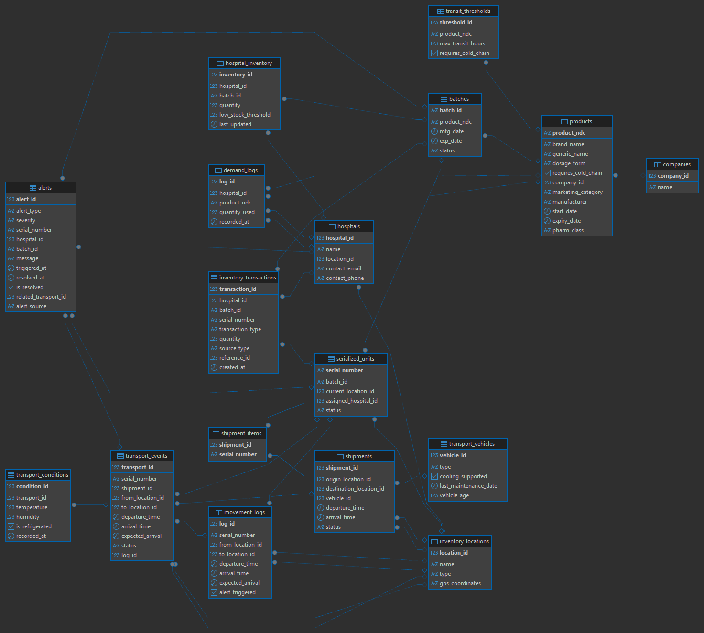

# Pharmaceutical Cold-Chain Tracking Database

A PostgreSQL database that traces pharmaceutical products from manufacturer to hospital: batches, serialized units, shipments, transport conditions, hospital stock levels and an alerting layer for transit delays, cold-chain risk, quarantines and low stock. Built as a group project for the SQL course at CEU.



## Why

Medicines, especially temperature-sensitive ones, can spoil, expire or be recalled while in transit, and hospitals can run out of critical stock. Unit-level traceability (serial number → batch → location history) makes it possible to answer: *where is this unit, which batches are affected by a recall, which shipments broke their time limits, and which hospitals are running low?*

## What's in it

- **~19 tables** in a normalized schema: `companies`, `products`, `batches`, `serialized_units`, `shipments`, `shipment_items`, `transport_vehicles`, `transport_events`, `transport_conditions`, `movement_logs`, `inventory_locations`, `hospitals`, `hospital_inventory`, `inventory_transactions`, `demand_logs`, `transit_thresholds`, `alerts` (plus a JSONB staging table).
- **Real product data** from the [openFDA NDC API](https://open.fda.gov/apis/drug/ndc/) (~25,000 records): product codes, names, dosage forms, manufacturers, routes.
- **Synthetic logistics data** (the FDA has no supply-chain data): hospitals, batches, serialized units with a realistic status mix, movement logs, hospital stock levels and alerts.
- **Cold-chain flag** derived from the FDA administration route (injectable routes are treated as cold-chain candidates, a proxy rather than a regulatory classification).

## Pipeline

| Step | Script | What it does |
|---|---|---|
| 1 | `etl/01_fetch_fda_data.py` | Pages through the openFDA API (1,000 records per call, within its rate and `skip` limits) and saves `fda_data.json` |
| 2 | `etl/02_load_staging.py` | Loads the raw JSON into a JSONB staging table |
| 3 | `etl/03_populate_companies.py` | Inserts unique manufacturers (`labeler_name`) into `companies` |
| 4 | `etl/04_load_products.py` | Maps FDA fields to the `products` table (idempotent, `ON CONFLICT DO NOTHING`) |
| 5 | `etl/05_patch_products.py` | Links products to companies and fills the cold-chain flag and pharmacological class |
| 6 | `synthetic/generate_synthetic_data.py` | Generates locations, hospitals, transit thresholds, batches, serialized units, movement logs, hospital inventory and alerts |
| 7 | `analysis/cold_chain_and_transit_analysis.ipynb` | SQL + pandas + SciPy analysis (below) |

## Analysis

Both analyses run on the synthetic data, so they validate the pipeline and the queries rather than say anything about real supply chains.

- **Do cold-chain products generate more alerts?** Independent-samples t-test on alerts per product (70 cold-chain vs 430 other products): mean 0.50 vs 0.62, t = −1.14, p = 0.256, so no significant difference.
- **Does transit time differ by origin location?** Across ~14.8k movement logs and 30 locations (mean ≈ 12 h), a Kruskal-Wallis test gives H = 32.70, p = 0.29, so no significant difference. This is expected: transit times were drawn from the same distribution.

## Run it

```bash
python -m venv .venv && source .venv/bin/activate   # Windows: .venv\Scripts\activate
pip install -r requirements.txt

cp .env.example .env        # fill in your DB credentials and openFDA API key
psql -f schema/schema.sql   # or run it from any SQL client

python etl/01_fetch_fda_data.py
python etl/02_load_staging.py
python etl/03_populate_companies.py
python etl/04_load_products.py
python etl/05_patch_products.py
python synthetic/generate_synthetic_data.py
```

Run scripts from the repository root (they read `fda_data.json` and `.env` from the current directory). The original project ran on a university PostgreSQL server that is not publicly accessible, so you need your own PostgreSQL instance to reproduce it. `schema/schema.sql` was reconstructed from the ER diagram, so data types are best-effort.

## Tech stack

PostgreSQL · Python (psycopg2, requests, pandas, SQLAlchemy, SciPy, seaborn/matplotlib) · openFDA REST API · JSONB staging

## Team

Group project with Alnura Abdyrova.

- **Synthetic data generation:** built solely by me (`synthetic/generate_synthetic_data.py`).
- **Schema design and analysis:** done jointly with Alnura Abdyrova(Abdyrova_AInura@student.ceu.edu).
- **FDA ETL scripts (fetch, staging, companies, products, patch):** done solely by me

